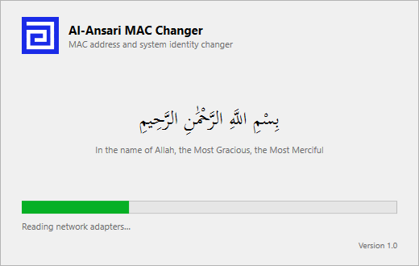
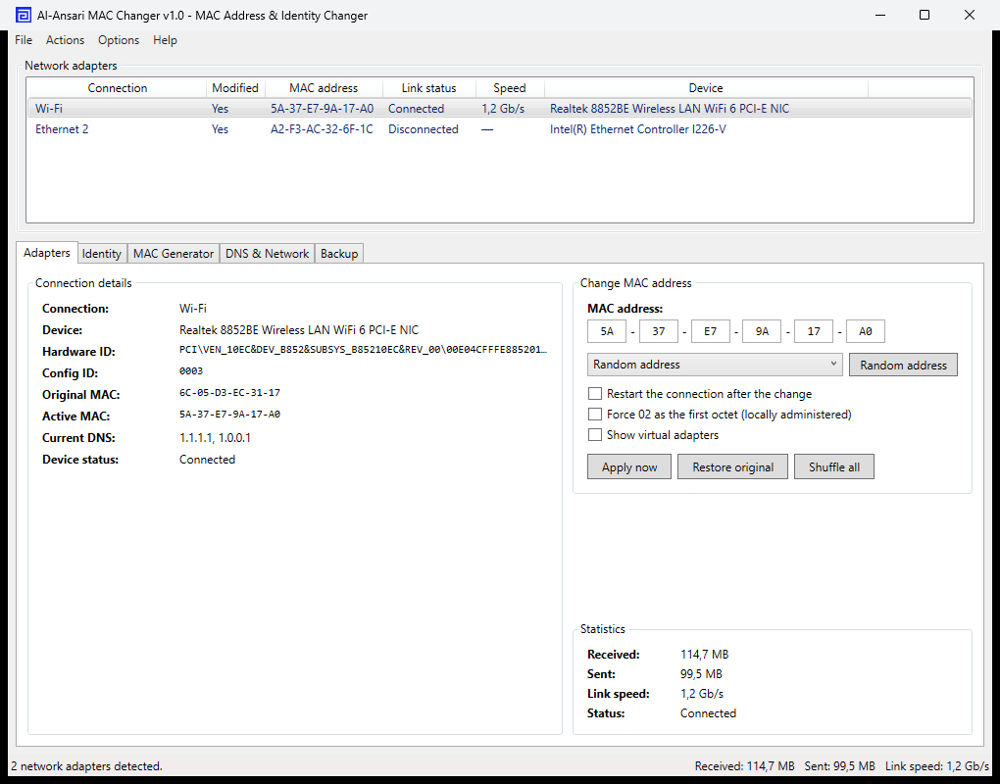
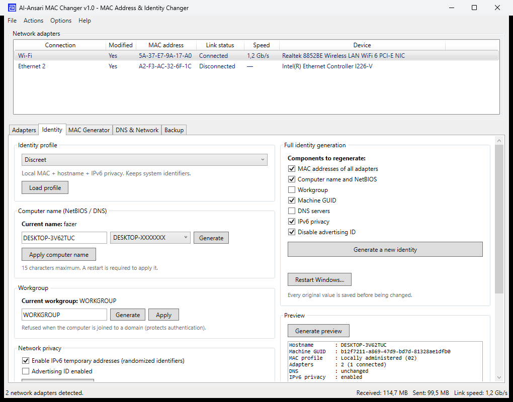
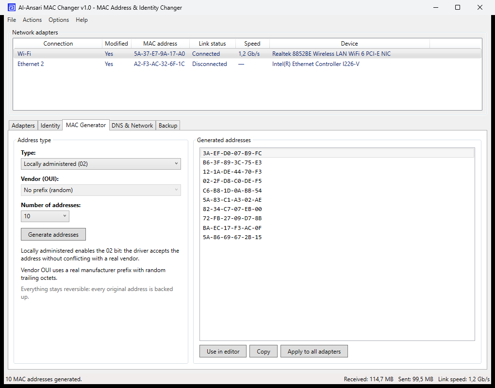
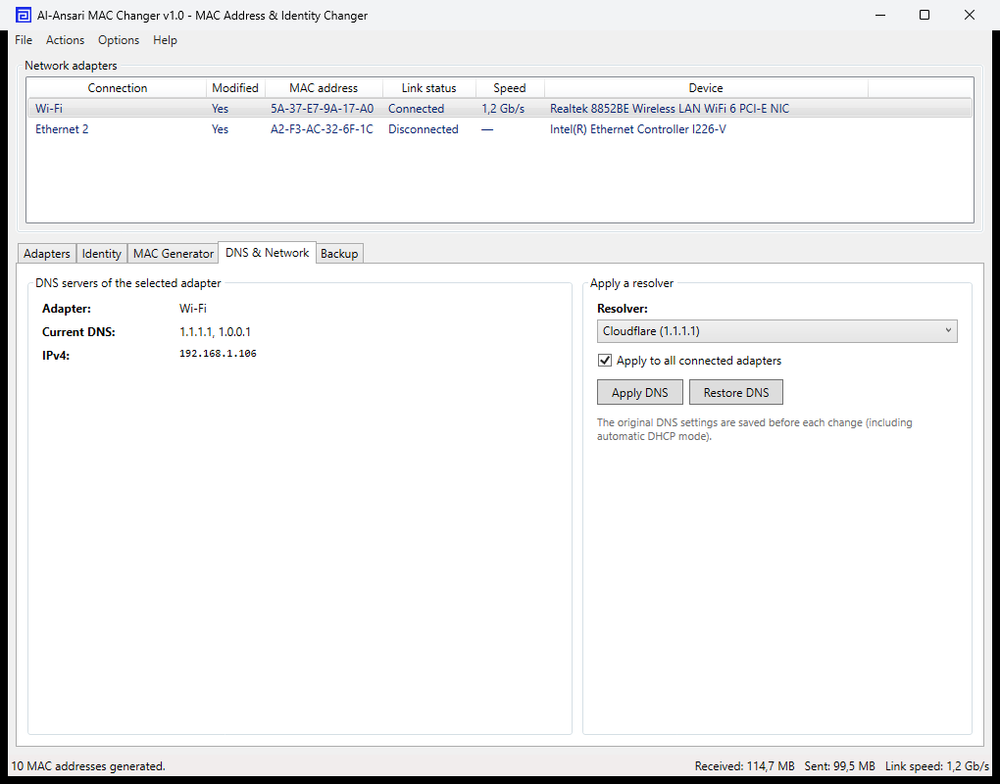
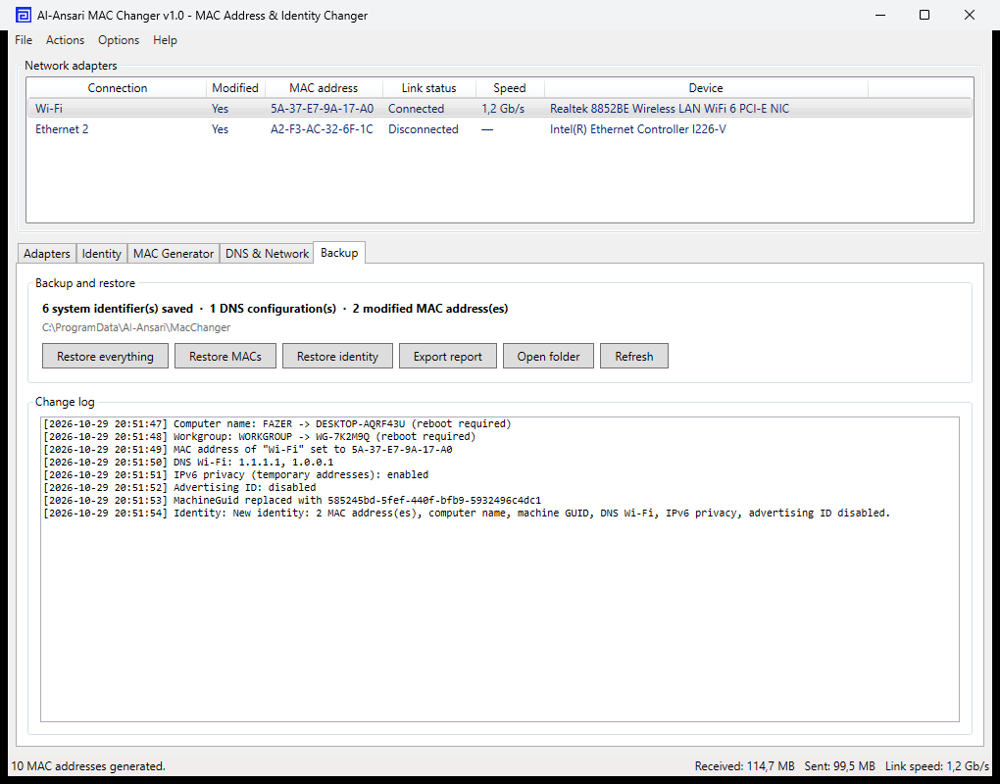

<p align="center">
  
</p>

<h1 align="center">AL-ANSARI SOFTWARES</h1>
<h3 align="center">Al-Ansari MAC Changer</h3>

<p align="center">
  A classic Windows utility that changes MAC addresses and generates a complete, reversible system identity.
</p>

<p align="center">
  <a href="https://github.com/urbanyl/al-ansari-mac-changer/releases/latest"></a>
  <a href="https://github.com/urbanyl/al-ansari-mac-changer/releases"></a>
  
  
  
  
  <a href="https://github.com/urbanyl/al-ansari-mac-changer/stargazers"></a>
</p>

---

## Table of contents

- [Overview](#overview)
- [Screenshots](#screenshots)
- [Features](#features)
  - [MAC address engine](#mac-address-engine)
  - [System identity](#system-identity)
  - [Network privacy](#network-privacy)
  - [Profiles and preview](#profiles-and-preview)
  - [Safety and restore](#safety-and-restore)
- [Requirements](#requirements)
- [Installation](#installation)
- [Usage](#usage)
- [Build from source](#build-from-source)
- [How it works](#how-it-works)
- [Data and backups](#data-and-backups)
- [Project structure](#project-structure)
- [Disclaimer](#disclaimer)
- [License](#license)

---

## Overview

**Al-Ansari MAC Changer** is a native WPF application (no Electron, no browser engine) that looks and behaves like a classic Windows tool. It changes network adapter MAC addresses, then optionally renews a full machine identity: computer name, NetBIOS name, workgroup, MachineGuid, DNS resolvers, IPv6 temporary addresses and the advertising ID.

Every change is written to a local backup first, so everything can be restored. The app requires administrator rights and keeps running in the notification area when its window is closed.

The startup screen displays the Basmala in Arabic:

> بِسْمِ اللَّهِ الرَّحْمَٰنِ الرَّحِيمِ

## Screenshots

| Startup | Adapters |
| --- | --- |
|  |  |

| Identity | MAC generator |
| --- | --- |
|  |  |

| DNS and network | Backup and log |
| --- | --- |
|  |  |

## Features

### MAC address engine

- Three address types: **locally administered (02)**, **universally administered**, and **vendor OUI**.
- 40 manufacturer prefixes (Apple, Intel, Samsung, Dell, HP, Lenovo, Cisco, Asus, Realtek, TP-Link, Ubiquiti, Raspberry Pi, VMware, VirtualBox, and more).
- Generate up to **100 candidate addresses**, copy one, load it into the editor, or apply a fresh address to every adapter.
- “Shuffle all” changes all adapters in one click.
- Force the locally-administered bit (`02`) when a driver rejects vendor prefixes.
- Original MAC addresses are remembered per adapter, including adapters that were already spoofed before the first run.

### System identity

- **Computer name / NetBIOS** with 10 name styles (`DESKTOP-`, `PC-`, `LAPTOP-`, `WORKSTATION-`, `OFFICE-`, `HOME-`, `WIN-`, `LAB-`, `NODE-`, `STATION-`), validated against the 15-character NetBIOS limit.
- **Workgroup** renaming, automatically refused on domain-joined machines to protect authentication.
- **MachineGuid** rotation with backup (some licenses are tied to it — a warning is shown).
- **Advertising ID** toggle.

### Network privacy

- 12 DNS resolvers: Cloudflare, Cloudflare Family, Quad9, Google, OpenDNS, AdGuard, Mullvad, NextDNS, dns0.eu, ControlD, LibreDNS and DNS.SB.
- Apply DNS to one adapter or to every connected adapter; the original configuration is backed up, including automatic DHCP mode.
- IPv6 temporary addresses and randomized identifiers through `netsh`.

### Profiles and preview

Five one-click identity profiles load the right combination of options:

| Profile | What it does |
| --- | --- |
| Discreet | Local MAC, new hostname, IPv6 privacy |
| Corporate | Vendor MAC, `WIN-` hostname, MachineGuid, Quad9 DNS |
| Full makeover | MAC, hostname, workgroup, MachineGuid, DNS, IPv6, advertising ID |
| Network only | MAC, DNS and IPv6 privacy |
| Privacy only | IPv6 privacy and advertising ID |

A **preview panel** shows the proposed hostname, GUID, MAC profile, DNS, workgroup and restart requirement before anything is applied.

### Safety and restore

- Automatic backup of every original value in `%ProgramData%\Al-Ansari\MacChanger\backup.json`.
- Change journal (`history.log`) and one-click **Export report**.
- Restore individual adapters, all MAC addresses, the system identity, or everything at once.
- Startup elevation through `requireAdministrator`; the app closes to the tray, never silently in the background.
- No driver, no kernel component, no service installation: registry and documented Windows APIs only.

## Requirements

- Windows 10 or Windows 11 (x64).
- Administrator rights (requested automatically at launch).
- For the source build: .NET 10 SDK with the Windows Desktop workload.
- The release package is self-contained; no .NET runtime installation is needed.

## Installation

1. Open the [latest release](https://github.com/urbanyl/al-ansari-mac-changer/releases/latest).
2. Download `Al-Ansari-MAC-Changer-1.0.0-win-x64.zip`.
3. Extract the archive anywhere.
4. Run `AlAnsariMacChanger.exe` and accept the UAC prompt.

The application starts with the Basmala splash screen, then opens the main window. Closing the window keeps the app in the notification area; use **Quit** in the tray menu to exit.

## Usage

1. Select an adapter in the list.
2. Choose a MAC type in the **MAC Generator** tab, generate addresses, then use one.
3. Apply it in the **Adapters** tab (optionally restart the connection; disabled by default to avoid connectivity loss).
4. To renew the whole identity, open **Identity**, pick a profile, review the preview, then click **Generate a new identity**.
5. Restart Windows when prompted (computer name and workgroup changes require it).
6. To undo everything, open **Backup** and click **Restore everything**.

## Build from source

```powershell
git clone https://github.com/urbanyl/al-ansari-mac-changer.git
cd al-ansari-mac-changer
dotnet build -c Release
dotnet run --project AlAnsariMacChanger
```

Publish a self-contained single file:

```powershell
dotnet publish AlAnsariMacChanger/AlAnsariMacChanger.csproj `
  -c Release -r win-x64 --self-contained true `
  -p:PublishSingleFile=true `
  -p:IncludeNativeLibrariesForSelfExtract=true `
  -o artifacts/win-x64
```

## How it works

| Identifier | Mechanism |
| --- | --- |
| MAC address | `NetworkAddress` value in `HKLM\SYSTEM\CurrentControlSet\Control\Class\{4d36e972-...}\<NNNN>` (WMI `Win32_NetworkAdapter` for discovery) |
| Computer name / NetBIOS | `SetComputerNameEx` (`ComputerNamePhysicalDnsHostname` and `ComputerNamePhysicalNetBIOS`) |
| Workgroup | `HKLM\SYSTEM\CurrentControlSet\Services\Tcpip\Parameters\Workgroup` |
| MachineGuid | `HKLM\SOFTWARE\Microsoft\Cryptography\MachineGuid` |
| DNS | WMI `Win32_NetworkAdapterConfiguration.SetDNSServerSearchOrder` |
| IPv6 privacy | `netsh interface ipv6 set global randomizeidentifiers` / `set privacy state` |
| Advertising ID | `HKCU\SOFTWARE\Microsoft\Windows\CurrentVersion\AdvertisingInfo\Enabled` |

No kernel driver, no packet interception, no service.

## Data and backups

```
%ProgramData%\Al-Ansari\MacChanger\
├── backup.json        original identities and DNS configurations
├── history.log        change journal
└── report-*.txt       exported reports
```

MAC originals are stored next to the application data as well, so already-spoofed adapters can be recovered.

## Project structure

```
Al-Ansari-Mac-Changer/
├── AlAnsariMacChanger/
│   ├── Infrastructure/     commands and observable objects
│   ├── Models/             adapters, presets, profiles
│   ├── Services/           adapters, identity, backup store
│   ├── ViewModels/         main view model
│   ├── Assets/             application icon
│   ├── SplashWindow.*      Basmala splash screen
│   └── MainWindow.*        classic Win32-style UI
├── docs/
│   ├── logo.png / logo.svg
│   └── screenshots/
├── LICENSE
└── README.md
```

## Disclaimer

This tool is intended for privacy, testing and administration on devices you own or are authorized to manage. Changing identifiers may affect network access, domain membership, DHCP reservations and software licenses. Always keep the built-in backups; a restart may be required. The authors are not responsible for misuse or for any damage resulting from the use of this software.

## License

[MIT](LICENSE) © 2026 Al-Ansari Softwares
